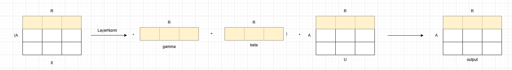

# ln_mul

## 产品支持情况

| 产品 | 是否支持 |
| :--- | :------: |
| Atlas 950 训练/推理系列产品 | √ |
| Atlas A3  训练/推理系列产品 | √ |
| Atlas A2  训练/推理系列产品 | √ |

## 功能说明

对输入 X 进行 LayerNorm，再将结果与 gamma、beta 计算，最后与输入 U 做乘法。

计算公式：

```text
output = LayerNorm(X) * U
LayerNorm(X) = rstd * (x - mean) * gamma + beta
```



对应接口：

- aclnn 接口：`aclnnLnMul`
- torch 接口：`ops_rec.ascendc.activation.ln_mul`

## 算子实现原理

算子采用 AscendC 进行开发，其中 LayerNorm 部分使用基础 API 实现。具体计算步骤如下：

1. 计算输入 X 每一行元素的和
2. 计算上述结果的均值 mean
3. 计算输入 X 与 mean 的差值 X - mean
4. 计算 (X - mean) * (X - mean)
5. 计算上述结果每一行的均值即方差 var
6. 计算标准差的倒数 rstd = 1.0 / sqrt(var + ε)
7. 计算 LayerNorm 结果 rstd * (X - mean) * gamma + beta
8. 计算最终输出 output = LayerNorm(X) * U

## 参数说明

| 参数名 | 输入/输出 | 参数类型 | 数据类型 | 数据格式 | shape | 说明 |
|--------|---------|---------|---------|---------|-------|------|
| x | 输入 | Tensor | FLOAT32 | ND | [A, R] | 输入数据 |
| u | 输入 | Tensor | FLOAT32 | ND | [A, R] | 输入数据 |
| gamma | 输入 | Tensor | FLOAT32 | ND | [R] | LayerNorm 权重 |
| beta | 输入 | Tensor | FLOAT32 | ND | [R] | LayerNorm 偏置 |
| output | 输出 | Tensor | FLOAT32 | ND | [A, R] | 输出数据 |

## 约束说明

- 仅支持 FLOAT32 数据类型
- X、U 必须为 2D 且 shape 相同
- gamma、beta 必须为 1D
- 该算子需要在 NPU 设备上运行

> 通过 torch 接口调用时，扩展层还会额外校验：输入 tensor 必须已定义且非空、所有输入 tensor 必须位于同一 NPU 设备。详见 [ln_mul 接口文档](./docs/torch_ln_mul.md)。

## 调用示例

- [aclnn 调用示例](./examples/aclnn/test_aclnn_ln_mul.cpp)
- [torch 调用示例](./examples/torch/test_torch_ln_mul.py)
- [aclnn 接口文档](./docs/aclnn_ln_mul.md)
- [torch 接口文档](./docs/torch_ln_mul.md)
