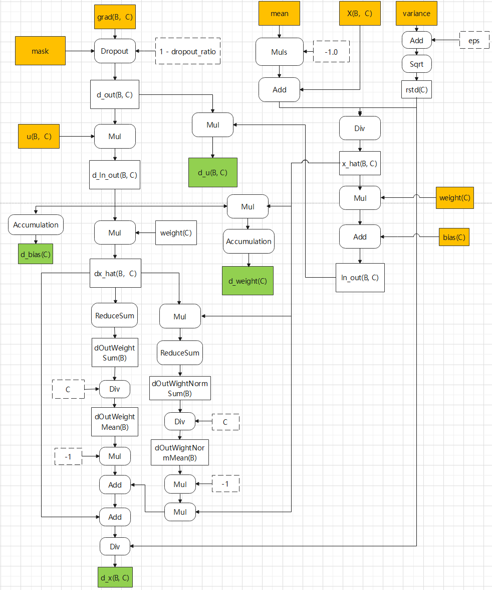

# norm_multiply_dropout_backward

## 产品支持情况

| 产品 | 是否支持 |
| :--- | :------: |
| Ascend 950PR&950DT系列产品 | √ |
| Atlas A3系列产品 | √ |
| Atlas A2系列产品 | √ |

## 功能说明

实现 LayerNorm + multiply + dropout 计算的反向求导逻辑对应的融合算子功能，对应前向算子 [norm_multiply_dropout_forward](../norm_multiply_dropout_forward/README.md)。

计算公式：

```text
d_u   = d_out * ln_ret * (1 - drop_mask)
d_x   = LayerNormBackward(d_out * u * (1 - drop_mask), x, weight, mean, var, eps)
d_weight = reduce_sum(d_out * u * (1 - drop_mask) * norm_x, dim=0)
d_bias   = reduce_sum(d_out * u * (1 - drop_mask), dim=0)
```

对应接口：

- aclnn 接口：`aclnnNormMultiplyDropoutBackward`
- torch 接口：通过 PyTorch 自动求导框架调用（`ops_rec.ascendc.activation.norm_multiply_dropout` 前向接口注册的 backward）

## 算子实现原理

算子基于 AscendC 开发，输入为前向计算的入参/中间结果与上游梯度 d_out，在单个 Kernel 内完成 dropout mask 还原、multiply 反传与 LayerNorm 反传，并按需做跨核归约得到 d_weight / d_bias。



Kernel 通过 tilingKey 模板参数 `isNeedDrop`（0/1）区分是否执行 dropout 分支。

## 参数说明

| 参数名 | 输入/输出 | 参数类型 | 数据类型 | 数据格式 | shape | 说明 |
| -------- | --------- | --------- | --------- | --------- | ------- | ------ |
| d_out | 输入 | Tensor | FLOAT32 / FLOAT16 / BFLOAT16 | ND | [B, C] | 上游梯度，数据类型需与 x 一致，B∈[1, 1000000]，C 仅支持 512、1024 |
| x | 输入 | Tensor | FLOAT32 / FLOAT16 / BFLOAT16 | ND | [B, C] | 前向输入 |
| u | 输入 | Tensor | FLOAT32 / FLOAT16 / BFLOAT16 | ND | [B, C] | 数据类型需与 x 一致 |
| weight | 输入 | Tensor | FLOAT32 / FLOAT16 / BFLOAT16 | ND | [C] | 数据类型需与 x 一致 |
| bias | 输入 | Tensor | FLOAT32 / FLOAT16 / BFLOAT16 | ND | [C] | 数据类型需与 x 一致 |
| mean | 输入 | Tensor | FLOAT32 | ND | [B] | 前向输出的均值 |
| var | 输入 | Tensor | FLOAT32 | ND | [B] | 前向输出的方差 |
| mask | 输入 | Tensor | UINT8 | ND | 约为 x 元素个数的 1/8 | 前向 dropout 生成的掩码 |
| eps | 输入（属性） | float | FLOAT | - | - | 防除 0 极小值，取值范围 [1e-10, 1e-4] |
| dropout_ratio | 输入（属性） | float | FLOAT | - | - | 取值范围 [0.0, 1.0]；<= 1e-10 时按概率 0 处理 |
| d_u | 输出 | Tensor | FLOAT32 / FLOAT16 / BFLOAT16 | ND | [B, C] | u 的梯度，数据类型与 x 一致 |
| d_x | 输出 | Tensor | FLOAT32 / FLOAT16 / BFLOAT16 | ND | [B, C] | x 的梯度，数据类型与 x 一致 |
| d_weight | 输出 | Tensor | FLOAT32 | ND | [C] | weight 的梯度，为保持累加精度固定为 FLOAT32 |
| d_bias | 输出 | Tensor | FLOAT32 | ND | [C] | bias 的梯度，为保持累加精度固定为 FLOAT32 |

## 约束说明

- 输入 tensor 值域 [-1, 1)，且数据必须连续（contiguous）
- **Ascend 950PR&950DT系列产品不支持输入 x 的 FLOAT32 数据类型**
- 除 d_out 外，其他输入均为前向计算的入参/输出，由 PyTorch 自动求导框架保存并传入
- 该算子不建议单独调用，建议通过 PyTorch 自动求导框架调用
- 该算子需要在 NPU 设备上运行

## 调用示例

- [torch 调用示例](./examples/torch/test_torch_norm_multiply_dropout_backward.py)
- [torch 功能测试](./test/pytest/test_norm_multiply_dropout_backward.py)
- [torch 接口文档](./docs/torch_norm_multiply_dropout_backward.md)
- [aclnn 接口文档](./docs/aclnn_norm_multiply_dropout_backward.md)
