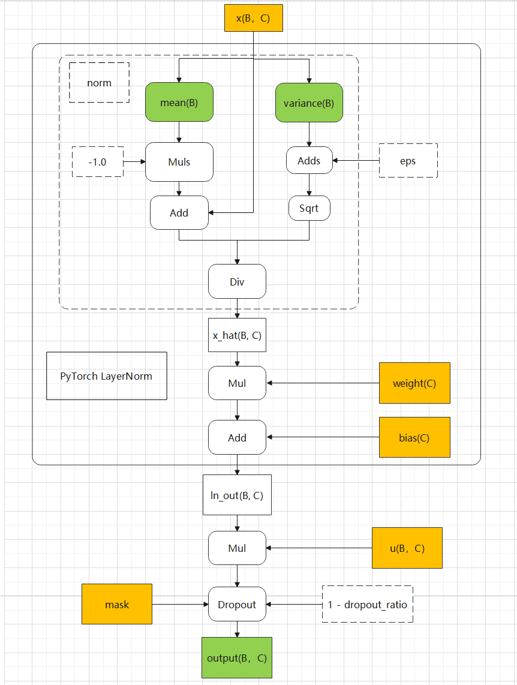

# norm_multiply_dropout_forward

## 产品支持情况

| 产品 | 是否支持 |
| :--- | :------: |
| Ascend 950PR&950DT系列产品 | √ |
| Atlas A3系列产品 | √ |
| Atlas A2系列产品 | √ |

## 功能说明

实现 LayerNorm + multiply + dropout 计算逻辑对应的融合算子功能。归一化操作对应 PyTorch 的 LayerNorm，包含标准归一化 + 仿射变换。

计算公式：

```text
ln_ret = LayerNorm(x) * weight + bias
ln_out = u * ln_ret
output = dropout(ln_out, p=dropout_ratio)   # dropout_ratio <= 1e-10 时不做 dropout
```

对应接口：

- aclnn 接口：`aclnnNormMultiplyDropout`（反向为 `aclnnNormMultiplyDropoutBackward`）
- torch 接口：`ops_rec.ascendc.activation.norm_multiply_dropout`（支持自动求导）

## 算子实现原理

算子基于 AscendC 开发，将 LayerNorm、multiply、dropout 融合在单个 Kernel 内完成。计算逻辑如下：



伪代码（golden 参考）：

```python
def norm_multiply_dropout_pt(x, u, weight, bias, eps, dropout_ratio):
    ori_dtype = x.dtype
    x = x.to(torch.float32)
    u = u.to(torch.float32)
    weight = weight.to(torch.float32)
    bias = bias.to(torch.float32)

    ln_ret = F.layer_norm(x, normalized_shape=[x.shape[-1]], weight=weight, bias=bias, eps=eps)
    ln_out = u * ln_ret
    ln_out = F.dropout(ln_out, p=dropout_ratio, training=True)
    return ln_out.to(ori_dtype)
```

Kernel 通过 tilingKey 模板参数 `isNeedDrop`（0/1）区分是否执行 dropout 分支。

## 参数说明

| 参数名 | 输入/输出 | 参数类型 | 数据类型 | 数据格式 | shape | 说明 |
| -------- | --------- | --------- | --------- | --------- | ------- | ------ |
| x | 输入 | Tensor | FLOAT32 / FLOAT16 / BFLOAT16 | ND | [B, C] | 输入数据，B∈[1, 1000000]，C 仅支持 512、1024 |
| u | 输入 | Tensor | FLOAT32 / FLOAT16 / BFLOAT16 | ND | [B, C] | 数据类型需与 x 一致 |
| weight | 输入 | Tensor | FLOAT32 / FLOAT16 / BFLOAT16 | ND | [C] | 数据类型需与 x 一致 |
| bias | 输入 | Tensor | FLOAT32 / FLOAT16 / BFLOAT16 | ND | [C] | 数据类型需与 x 一致 |
| mask | 输入 | Tensor | UINT8 | ND | 约为 x 元素个数的 1/8 | dropout 掩码，由 torch 适配层自动生成，无需用户手动构造 |
| eps | 输入（属性） | float | FLOAT | - | - | 防除 0 极小值，取值范围 [1e-10, 1e-4] |
| dropout_ratio | 输入（属性） | float | FLOAT | - | - | 取值范围 [0.0, 1.0]；<= 1e-10 时按概率 0 处理（不 dropout） |
| output | 输出 | Tensor | FLOAT32 / FLOAT16 / BFLOAT16 | ND | [B, C] | 前向计算结果，数据类型与 x 一致 |
| mean | 输出 | Tensor | FLOAT32 | ND | [B] | 归一化均值 |
| var | 输出 | Tensor | FLOAT32 | ND | [B] | 归一化方差 |

## 约束说明

- 输入 tensor 值域 [-1, 1)，且数据必须连续（contiguous）
- **Ascend 950PR&950DT系列产品不支持输入 x 的 FLOAT32 数据类型**
- B 取值范围 [1, 1000000]，C 仅支持 512、1024
- eps 取值范围 [1e-10, 1e-4]；dropout_ratio 取值范围 [0.0, 1.0]
- mask 由 torch 适配层在 dropout_ratio > 1e-10 时自动生成
- 该算子需要在 NPU 设备上运行

## 调用示例

- [torch 调用示例](./examples/torch/test_torch_norm_multiply_dropout.py)
- [torch 功能测试](./test/pytest/test_norm_multiply_dropout.py)
- [torch 接口文档](./docs/torch_norm_multiply_dropout.md)
- [aclnn 接口文档](./docs/aclnn_norm_multiply_dropout.md)
- 反向算子：[norm_multiply_dropout_backward](../norm_multiply_dropout_backward/README.md)
