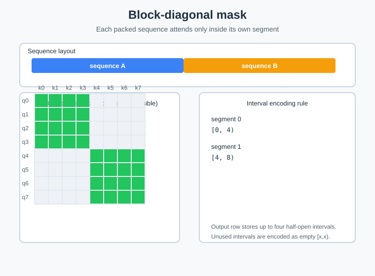

# aclnnBuildBlockDiagonalMaskArbitraryFunc

## 产品支持情况

| 产品 | 是否支持 |
| :--- | :------: |
| Ascend 950PR&950DT系列产品 | √ |
| Atlas A3系列产品 | × |
| Atlas A2系列产品 | × |

## 功能说明

根据 Block Diagonal 规则构造 arbitrary function 掩码编码（af 编码）：对每个全局位置 `pos`，
二分查找 `offsets` 定位所属序列 `seq_id`，输出该序列的可见区间 `[seq_start, seq_end)`。

设 `seq_start=offsets[seq_id]`、`seq_end=offsets[seq_id+1]`：

- 每个 query 仅能看到**自身所在序列**的所有 key（序列内全连接，序列间完全隔离）
- `af[pos][0] = seq_start`（可见区间起始）
- `af[pos][1] = seq_end`（可见区间结束，半开）

输出 shape `[1, 1, total_seqlen, 2]`，每个 query 可见 key 集合 = `[col0, col1)`（全局索引）。

### 编码示意图



## 函数原型

两段式接口，必须先调用 `aclnnBuildBlockDiagonalMaskArbitraryFuncGetWorkspaceSize` 接口获取 workspace 大小和执行器，
再调用 `aclnnBuildBlockDiagonalMaskArbitraryFunc` 接口执行计算。

```c
aclnnStatus aclnnBuildBlockDiagonalMaskArbitraryFuncGetWorkspaceSize(
    const aclTensor *offsets,
    int64_t totalSeqLen,
    const aclTensor *out,
    uint64_t *workspaceSize,
    aclOpExecutor **executor);

aclnnStatus aclnnBuildBlockDiagonalMaskArbitraryFunc(
    void *workspace,
    uint64_t workspaceSize,
    aclOpExecutor *executor,
    aclrtStream stream);
```

## aclnnBuildBlockDiagonalMaskArbitraryFuncGetWorkspaceSize

### 参数说明

| 参数名 | 输入/输出 | 描述 | 数据类型 | 数据格式 |
|--------|---------|------|---------|---------|
| offsets（aclTensor） | 输入 | 每序列起始偏移，shape [batch_size+1] | INT32 | ND |
| totalSeqLen（int64_t） | 输入 | 所有序列长度之和，须等于 `offsets` 最后一个元素 | INT64 | 标量 |
| out（aclTensor） | 输出 | af 编码输出，shape [1,1,total_seqlen,2] | INT32 | ND |
| workspaceSize（uint64_t*） | 输出 | 返回需要在 Device 侧申请的 workspace 大小 | UINT64 | 指针 |
| executor（aclOpExecutor**） | 输出 | 返回算子执行器 | 执行器指针 | 指针 |

### 返回值

| 返回值 | 错误码 | 描述 |
|--------|-------|------|
| ACLNN_ERR_PARAM_NULLPTR | 161001 | 传入参数是必选输入/输出且为空指针 |
| ACLNN_ERR_PARAM_INVALID | 161002 | 参数数据类型或数据格式不在支持范围内 |

## aclnnBuildBlockDiagonalMaskArbitraryFunc

### 参数说明

| 参数名 | 输入/输出 | 描述 |
|--------|---------|------|
| workspace | 输入 | 在 Device 侧申请的 workspace 内存地址 |
| workspaceSize | 输入 | workspace 大小，由 `aclnnBuildBlockDiagonalMaskArbitraryFuncGetWorkspaceSize` 获取 |
| executor | 输入 | 算子执行器 |
| stream | 输入 | 指定执行任务的 Stream |

### 返回值

aclnnStatus：返回状态码，成功返回 `ACLNN_SUCCESS`。

## 约束说明

- 仅支持 INT32 数据类型
- `offsets` 必须为 1D, `offsets[0]` 必须为 0、`offsets` 严格单调递增
- `totalSeqLen` 须等于 `offsets[-1]`
- 该算子需要在 NPU 设备上运行

## 调用示例

具体参考 [test_aclnn_arbitrary_func_block_diagonal_mask.cpp](../examples/aclnn/test_aclnn_arbitrary_func_block_diagonal_mask.cpp) 的完整实现。
