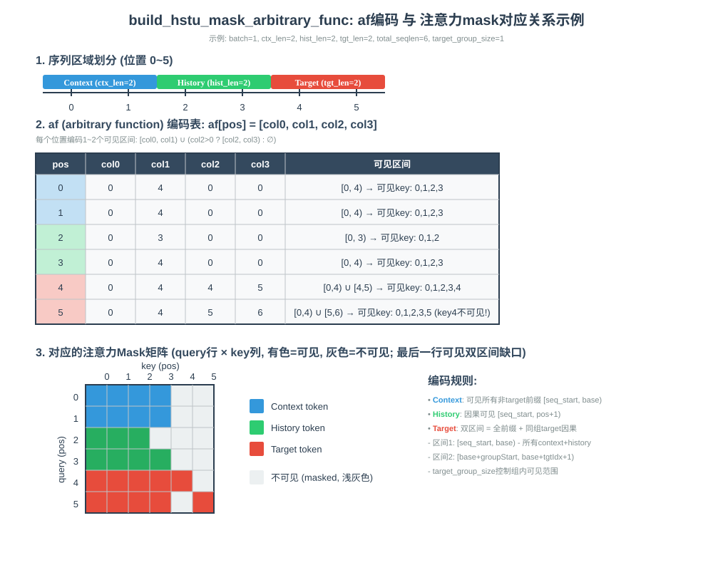

# aclnnBuildHstuMaskArbitraryFunc

## 产品支持情况

| 产品 | 是否支持 |
| :--- | :------: |
| Atlas 950 系列产品 | √ |
| Atlas A3  训练/推理系列产品 | × |
| Atlas A2  训练/推理系列产品 | × |

## 功能说明

根据每个序列的 `offsets` / `ctx_lens` / `tgt_lens`，构造 arbitrary function 掩码编码（af 编码）。

对每个全局位置 `pos`，二分查找 `offsets` 定位所属序列 `seq_id`，再按 `pos_in_seq` 与
`ctx_len` / `hist_end` 三段判断 ctx / history / target，写出 `af[pos][0..3]` 四个列：

- context token（`pos_in_seq < ctx_len`）：`col0=seq_start, col1=base, col2=0, col3=0`
- history token（`pos_in_seq < hist_end`）：`col0=seq_start, col1=pos+1, col2=0, col3=0`
- target token（否则）：记 `tgt_idx=pos_in_seq-hist_end`，
  `group_start=(tgt_idx/target_group_size)*target_group_size`：
  `col0=seq_start, col1=base, col2=base+group_start, col3=base+tgt_idx+1`

其中 `seq_start=offsets[seq_id]`，`base=seq_start+hist_end`，`hist_end=ctx_len+hist_len`，
`hist_len=seq_len-ctx_len-tgt_len`。

### 编码示意图



## 函数原型

两段式接口，必须先调用 `aclnnBuildHstuMaskArbitraryFuncGetWorkspaceSize` 接口获取 workspace 大小和执行器，
再调用 `aclnnBuildHstuMaskArbitraryFunc` 接口执行计算。

```c
aclnnStatus aclnnBuildHstuMaskArbitraryFuncGetWorkspaceSize(
    const aclTensor *offsets,
    const aclTensor *ctxLens,
    const aclTensor *tgtLens,
    int64_t targetGroupSize,
    int64_t totalSeqLen,
    const aclTensor *out,
    uint64_t *workspaceSize,
    aclOpExecutor **executor);

aclnnStatus aclnnBuildHstuMaskArbitraryFunc(
    void *workspace,
    uint64_t workspaceSize,
    aclOpExecutor *executor,
    aclrtStream stream);
```

## aclnnBuildHstuMaskArbitraryFuncGetWorkspaceSize

### 参数说明

| 参数名 | 输入/输出 | 描述 | 数据类型 | 数据格式 |
|--------|---------|------|---------|---------|
| offsets（aclTensor） | 输入 | 每序列起始偏移，shape [batch_size+1] | INT32 | ND |
| ctxLens（aclTensor） | 输入 | 每序列 context 长度，shape [batch_size] | INT32 | ND |
| tgtLens（aclTensor） | 输入 | 每序列 target 长度，shape [batch_size] | INT32 | ND |
| targetGroupSize（int64_t） | 输入 | target 分组的组大小标量 | INT64 | 标量 |
| totalSeqLen（int64_t） | 输入 | 所有序列长度之和，须等于 `offsets` 最后一个元素 | INT64 | 标量 |
| out（aclTensor） | 输出 | af 编码输出，shape [1,1,total_seqlen,4] | INT32 | ND |
| workspaceSize（uint64_t*） | 输出 | 返回需要在 Device 侧申请的 workspace 大小 | UINT64 | 指针 |
| executor（aclOpExecutor**） | 输出 | 返回算子执行器 | 执行器指针 | 指针 |

### 返回值

| 返回值 | 错误码 | 描述 |
|--------|-------|------|
| ACLNN_ERR_PARAM_NULLPTR | 161001 | 传入参数是必选输入/输出且为空指针 |
| ACLNN_ERR_PARAM_INVALID | 161002 | 参数数据类型或数据格式不在支持范围内 |

## aclnnBuildHstuMaskArbitraryFunc

### 参数说明

| 参数名 | 输入/输出 | 描述 |
|--------|---------|------|
| workspace | 输入 | 在 Device 侧申请的 workspace 内存地址 |
| workspaceSize | 输入 | workspace 大小，由 `aclnnBuildHstuMaskArbitraryFuncGetWorkspaceSize` 获取 |
| executor | 输入 | 算子执行器 |
| stream | 输入 | 指定执行任务的 Stream |

### 返回值

aclnnStatus：返回状态码，成功返回 `ACLNN_SUCCESS`。

## 约束说明

- 仅支持 INT32 数据类型
- `offsets`、`ctxLens`、`tgtLens` 必须为 1D，且`ctxLens` / `tgtLens`维度须满足 `[batch_size]` / `[batch_size]`（`batch_size = offsets.size(0)-1`），否则算子执行（tiling 阶段）报错返回
- `totalSeqLen` 须等于 `offsets[-1]`
- 该算子需要在 NPU 设备上运行
- `targetGroupSize` 须大于 0

## 调用示例

具体参考 [test_aclnn_arbitrary_func_hstu_mask.cpp](../examples/aclnn/test_aclnn_arbitrary_func_hstu_mask.cpp) 的完整实现。
