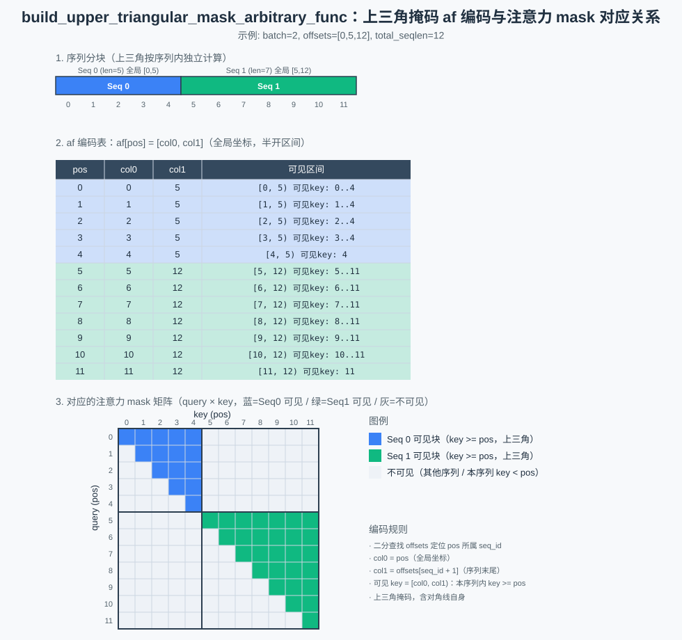

# aclnnBuildUpperTriangularMaskArbitraryFunc

## 产品支持情况

| 产品 | 是否支持 |
| :--- | :------: |
| Ascend 950PR&950DT系列产品 | √ |
| Atlas A3系列产品 | × |
| Atlas A2系列产品 | × |

## 功能说明

根据每个序列的 `offsets`，构造上三角掩码（upper-triangular mask）的
arbitrary function 编码（af 编码）。

对每个全局位置 `pos`，二分查找 `offsets` 定位所属序列 `seq_id`，写出 `af[pos][0..1]` 两个列
（单个半开区间 `[col0, col1)`，全局坐标）：

- `seq_end = offsets[seq_id + 1]`
- `col0 = pos`
- `col1 = seq_end`

即 query 位置 `pos` 可见的 key 集合 = `[col0, col1)`：本序列内满足 `key >= pos` 的 token
（含自身，上三角掩码），本序列内 `key < pos` 的 token 被掩蔽。

### 编码示意图



## 函数原型

两段式接口，必须先调用 `aclnnBuildUpperTriangularMaskArbitraryFuncGetWorkspaceSize` 接口获取 workspace 大小和执行器，
再调用 `aclnnBuildUpperTriangularMaskArbitraryFunc` 接口执行计算。

```c
aclnnStatus aclnnBuildUpperTriangularMaskArbitraryFuncGetWorkspaceSize(
    const aclTensor *offsets,
    int64_t totalSeqLen,
    const aclTensor *out,
    uint64_t *workspaceSize,
    aclOpExecutor **executor);

aclnnStatus aclnnBuildUpperTriangularMaskArbitraryFunc(
    void *workspace,
    uint64_t workspaceSize,
    aclOpExecutor *executor,
    aclrtStream stream);
```

## aclnnBuildUpperTriangularMaskArbitraryFuncGetWorkspaceSize

### 参数说明

| 参数名 | 输入/输出 | 描述 | 数据类型 | 数据格式 |
|--------|---------|------|---------|---------|
| offsets（aclTensor） | 输入 | 每序列起始偏移，shape [batch_size+1] | INT32 | ND |
| totalSeqLen（int64_t） | 输入 | 所有序列长度之和，须等于 `offsets` 最后一个元素 | INT64 | 标量 |
| out（aclTensor） | 输出 | af 编码输出，shape [1,1,total_seqlen,2] | INT32 | ND |
| workspaceSize（uint64_t*） | 输出 | 返回需要在 Device 侧申请的 workspace 大小 | UINT64 | 指针 |
| executor（aclOpExecutor**） | 输出 | 返回算子执行器 | 执行器指针 | 指针 |

### 返回值

| 返回值 | 错误码 | 描述 |
|--------|-------|------|
| ACLNN_ERR_PARAM_NULLPTR | 161001 | 传入参数是必选输入/输出且为空指针 |
| ACLNN_ERR_PARAM_INVALID | 161002 | 参数数据类型或数据格式不在支持范围内 |

## aclnnBuildUpperTriangularMaskArbitraryFunc

### 参数说明

| 参数名 | 输入/输出 | 描述 |
|--------|---------|------|
| workspace | 输入 | 在 Device 侧申请的 workspace 内存地址 |
| workspaceSize | 输入 | workspace 大小，由 `aclnnBuildUpperTriangularMaskArbitraryFuncGetWorkspaceSize` 获取 |
| executor | 输入 | 算子执行器 |
| stream | 输入 | 指定执行任务的 Stream |

### 返回值

aclnnStatus：返回状态码，成功返回 `ACLNN_SUCCESS`。

## 约束说明

- 仅支持 INT32 数据类型
- `offsets` 必须为 1D，且维度须满足 `[batch_size+1]`，否则算子执行（tiling 阶段）报错返回
- `totalSeqLen` 须等于 `offsets[-1]`
- 该算子需要在 NPU 设备上运行

## 调用示例

具体参考 [test_build_upper_triangular_mask_arbitrary_func.py](../test/pytest/test_build_upper_triangular_mask_arbitrary_func.py) 的完整实现。