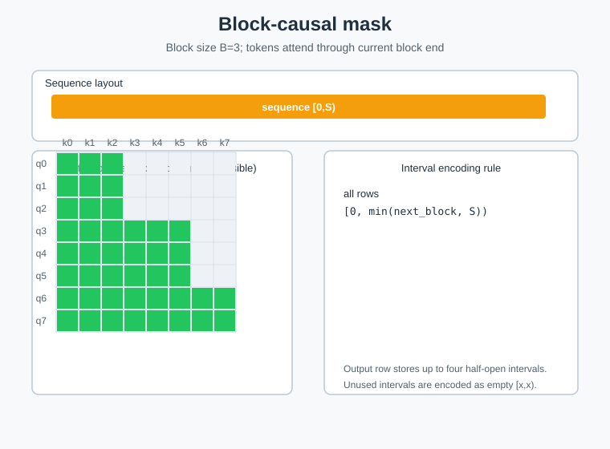

# build_block_causal_mask_arbitrary_func

## 产品支持情况

| 产品 | 是否支持 |
| :--- | :------: |
| Ascend 950PR&950DT系列产品 | √ |
| Atlas A3系列产品 | × |
| Atlas A2系列产品 | × |

## 功能说明

根据每个序列的 `offsets` / `block_sizes`，构造 Block-Causal 类型的 arbitrary function 掩码编码（af 编码）。

对每个全局位置 `pos`，二分查找 `offsets` 定位所属序列 `seq_id`，记 `seq_start=offsets[seq_id]`、
`seq_end=offsets[seq_id+1]`、`pos_in_seq=pos-seq_start`、`block_size=block_sizes[seq_id]`（为 0 时退化为 1）。

每个 query 仅能看到自身所在 block 及之前所有 block 的 keys：

- `block_start = floor(pos_in_seq / block_size) * block_size`
- `block_end   = min(block_start + block_size, seq_len)`

输出 `af[pos][0..1]` 两列：

- `col0 = seq_start`           — block 起点的全局索引
- `col1 = seq_start + block_end`  — block 终点（不含）的全局索引

即每个 query 可见的 keys 集合为 `[col0, col1)`（全局坐标，半开区间）。

输出 shape `[1, 1, total_seqlen, 2]`。

### 编码示意图



## 接口原型

```python
ops_rec.ascendc.attention.build_block_causal_mask_arbitrary_func(offsets, block_sizes, total_seqlen) -> Tensor
```

## 参数说明

| 参数名 | 输入/输出 | 参数类型 | 数据类型 | 数据格式 | shape | 说明 |
|--------|---------|---------|---------|---------|-------|------|
| offsets | 输入 | Tensor | INT32 | ND | [batch_size+1] | 每序列起始偏移 |
| block_sizes | 输入 | Tensor | INT32 | ND | [batch_size] | 每序列的 block 大小 |
| total_seqlen | 输入 | INT64 | - | - | - | 所有序列长度之和 |
| output | 输出 | Tensor | INT32 | ND | [1, 1, total_seqlen, 2] | af 编码输出 |

## 约束说明

约束分为两层：算子自身语义适用于 aclnn 与 torch 两条调用路径；torch 扩展层额外加的入参校验仅在调用
`ops_rec.ascendc.attention.build_block_causal_mask_arbitrary_func` 时生效。

### 算子约束

- 仅支持 INT32 数据类型
- `offsets` 必须为 1D，`offsets[0]` 必须为 0、`offsets` 严格单调递增
- `blockSizes` 必须为 1D，shape 须为 `[batch_size]`（`batch_size = offsets.size(0)-1`）
- `totalSeqLen` 须等于 `offsets[-1]`
- `blockSizes` 中各元素须 ≥ 0（为 0 时内部退化为 1）
- 该算子需要在 NPU 设备上运行

### torch 扩展层额外校验

由 [arbitrary_func_plugin.cpp](../torch_extension/arbitrary_func_plugin.cpp) 在调用算子前完成：

- 输入 tensor 必须已定义且非空
- 所有输入 tensor 必须位于同一 NPU 设备
- `offsets` / `block_sizes` 必须为 1D
- `block_sizes.size(0)` 必须等于 `offsets.size(0) - 1`
- `total_seqlen` 必须等于 `offsets[-1]`（读取 device 数据显式校验）
- 需要安装 `torch_npu`

## 安装方式

```bash
bash build.sh --install -j16
```

## 调用示例

完整调用示例参考 [test_torch_arbitrary_func_block_causal_mask.py](../examples/torch/test_torch_arbitrary_func_block_causal_mask.py)。
