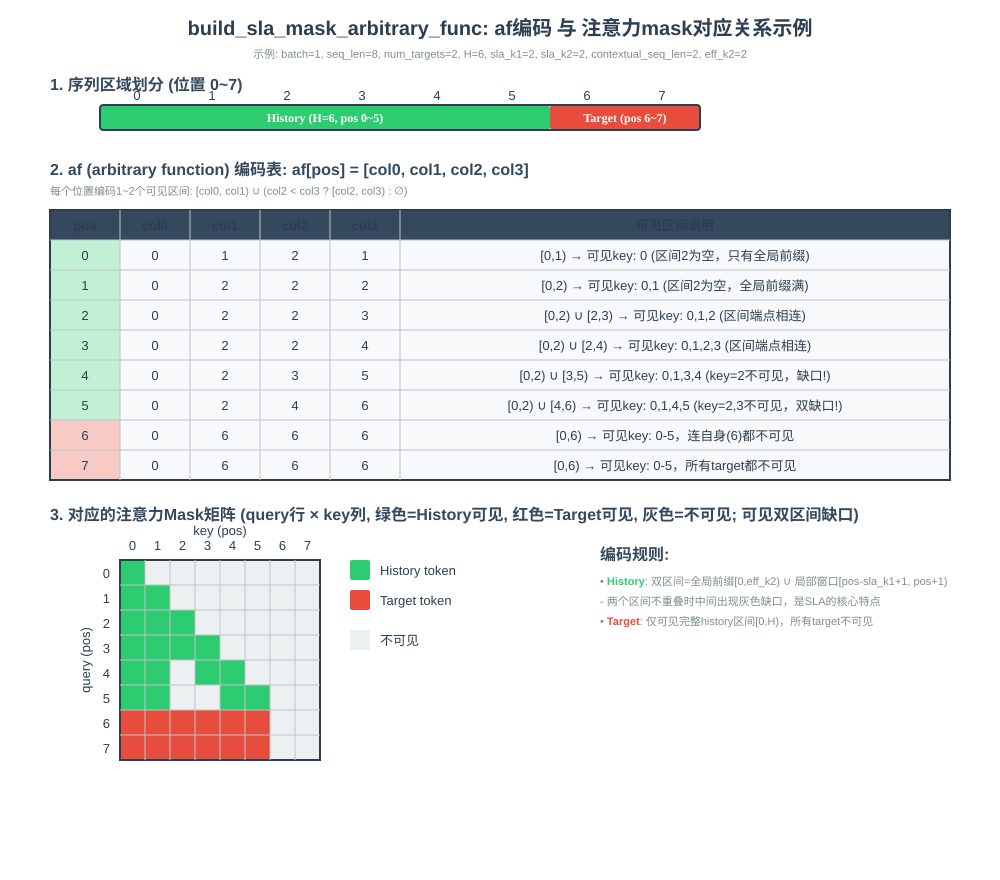

# build_sla_mask_arbitrary_func

## 产品支持情况

| 产品 | 是否支持 |
| :--- | :------: |
| Atlas 950 系列产品 | √ |
| Atlas A3  训练/推理系列产品 | × |
| Atlas A2  训练/推理系列产品 | × |

## 功能说明

根据 SLA（Semi-Local Attention）规则构造 arbitrary function 掩码编码（af 编码）：对每个全局位置 `pos`，
二分查找 `offsets` 定位所属序列 `seq_id`，计算局部位置与 history 边界后按 history / target 情况写出
`af[pos][0..3]` 四个列（全局坐标，半开区间 `[col0, col1) ∪ [col2, col3)`，`col3 ≤ col0` 视为空区间）。

设 `seq_start=offsets[seq_id]`、`seq_len=offsets[seq_id+1]-seq_start`、`pos_local=pos-seq_start`，
`eff_k2=max(sla_k2, contextual_seq_len)`、`H=max(seq_len-num_targets[seq_id], 0)`：

- history token（`pos_local < H`）：
  `c0=min(pos_local+1, eff_k2)`，`c1=max(eff_k2, pos_local-sla_k1+1)`，`c2=pos_local+1`
  → `col0=seq_start, col1=seq_start+c0, col2=seq_start+c1, col3=seq_start+c2`
- target token（`pos_local ≥ H`）：**只见完整 history `[0, H)`，连自身也不可见**
  `c0=c1=c2=H` → `col0=col1=col2=col3=seq_start+H`

输出 shape `[1, 1, total_seqlen, 4]`，head 维恒 1（所有 head 广播共享同一 mask）。

### 编码示意图



## 接口原型

```python
ops_rec.ascendc.attention.build_sla_mask_arbitrary_func(
    offsets, total_seqlen, sla_k1, sla_k2, contextual_seq_len, num_targets=None) -> Tensor
```

## 参数说明

| 参数名 | 输入/输出 | 参数类型 | 数据类型 | 数据格式 | shape | 说明 |
|--------|---------|---------|---------|---------|-------|------|
| offsets | 输入 | Tensor | INT32 | ND | [batch_size+1] | 每序列起始偏移（cu_seqlens） |
| total_seqlen | 输入 | INT64 | - | - | 标量 | 所有序列长度之和，须等于 `offsets[-1]` |
| sla_k1 | 输入 | INT64 | - | - | 标量 | Local 窗口大小 |
| sla_k2 | 输入 | INT64 | - | - | 标量 | Global 前缀长度 |
| contextual_seq_len | 输入 | INT64 | - | - | 标量 | context token 数，参与 `eff_k2=max(sla_k2, contextual_seq_len)` |
| num_targets | 输入（可选） | Tensor | INT32 | ND | [batch_size] | 每序列 target 数，shape 须为 [batch_size]；缺省 = 全 0（全部为 history token） |
| output | 输出 | Tensor | INT32 | ND | [1, 1, total_seqlen, 4] | af 编码输出 |

## 约束说明

约束分为两层：算子自身语义适用于 aclnn 与 torch 两条调用路径；torch 扩展层额外加的入参校验仅在调用
`ops_rec.ascendc.attention.build_sla_mask_arbitrary_func` 时生效。

### 算子约束

- 仅支持 INT32 数据类型
- `offsets` 必须为 1D, `offsets[0]` 必须为 0、`offsets` 严格单调递增
- `num_targets` 必须为 1D, `num_targets` shape 须为 `[batch_size]`（batch_size = offsets.size(0) - 1）
- `total_seqlen` 须等于 `offsets[-1]`
- `sla_k1`、`sla_k2`、`contextual_seq_len` 须大于等于 0
- 该算子需要在 NPU 设备上运行

### torch 扩展层额外校验

由 [arbitrary_func_plugin.cpp](../torch_extension/arbitrary_func_plugin.cpp) 在调用算子前完成：

- 输入 tensor 必须已定义且非空
- 所有输入 tensor 必须位于同一 NPU 设备
- 需要安装 `torch_npu`
- `total_seqlen` 必须等于 `offsets[-1]`（总 token 数），否则报错
- `num_targets` 传入时 shape 必须为 `[batch_size]`（= `offsets.size(0)-1`），否则报错
- `num_targets` 未定义/为空时自动以 `at::zeros([batch_size])` 补齐（等价于业务语义"缺省 = 全 0"）

## 安装方式

```bash
bash build.sh --install -j16
```

## 调用示例

完整调用示例参考 [test_torch_arbitrary_func_sla_mask.py](../examples/torch/test_torch_arbitrary_func_sla_mask.py)。
