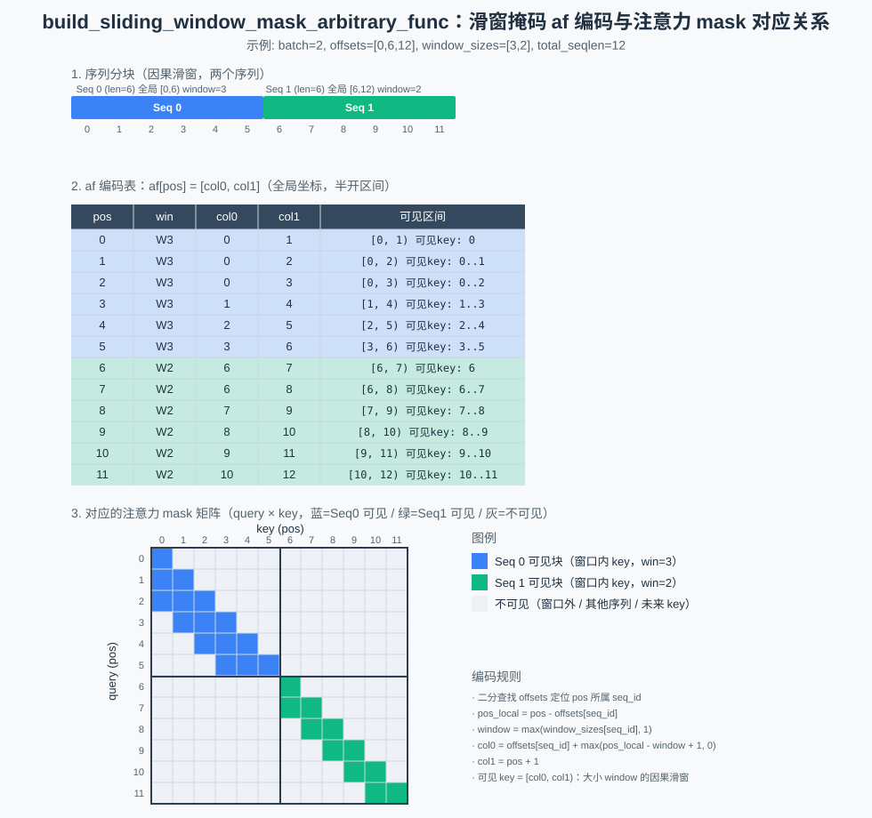

# build_sliding_window_mask_arbitrary_func

## 产品支持情况

| 产品 | 是否支持 |
| :--- | :------: |
| Ascend 950PR&950DT系列产品 | √ |
| Atlas A3系列产品 | × |
| Atlas A2系列产品 | × |

## 功能说明

根据每个序列的 `offsets` 与 `window_sizes`，构造滑窗掩码（sliding-window mask）的
arbitrary function 编码（af 编码）。

对每个全局位置 `pos`，二分查找 `offsets` 定位所属序列 `seq_id`，写出 `af[pos][0..1]` 两个列
（单个半开区间 `[col0, col1)`，全局坐标）：

- `window = max(window_sizes[seq_id], 1)`
- `col0 = offsets[seq_id] + max(pos_local - window + 1, 0)`（`pos_local = pos - offsets[seq_id]`）
- `col1 = pos + 1`

即 query 位置 `pos` 可见的 key 集合 = `[col0, col1)`：窗口大小为 `window` 的最近几个 key
（本序列内 `key <= pos` 的因果滑窗），窗口外的 key 被掩蔽。

### 编码示意图



## 接口原型

```python
ops_rec.ascendc.attention.build_sliding_window_mask_arbitrary_func(offsets, window_sizes, total_seqlen) -> Tensor
```

## 参数说明

| 参数名 | 输入/输出 | 参数类型 | 数据类型 | 数据格式 | shape | 说明 |
|--------|---------|---------|---------|---------|-------|------|
| offsets | 输入 | Tensor | INT32 | ND | [batch_size+1] | 每序列起始偏移 |
| window_sizes | 输入 | Tensor | INT32 | ND | [batch_size] | 每序列滑窗大小 |
| total_seqlen | 输入 | INT64 | - | - | - | 所有序列长度之和，须等于 `offsets[-1]` |
| output | 输出 | Tensor | INT32 | ND | [1, 1, total_seqlen, 2] | af 编码输出 |

## 约束说明

约束分为两层：算子自身语义适用于 aclnn 与 torch 两条调用路径；torch 扩展层额外加的入参校验仅在调用
`ops_rec.ascendc.attention.build_sliding_window_mask_arbitrary_func` 时生效。

### 算子约束

- 仅支持 INT32 数据类型
- `offsets` 必须为 1D，且维度须满足 `[batch_size+1]`
- `window_sizes` 必须为 1D，且维度须满足 `[batch_size]`（`batch_size = offsets.size(0)-1`），不满足时算子直接报错返回
- `total_seqlen` 须等于 `offsets[-1]`
- 该算子需要在 NPU 设备上运行

### torch 扩展层额外校验

由 [arbitrary_func_plugin.cpp](../torch_extension/arbitrary_func_plugin.cpp) 在调用算子前完成：

- 输入 tensor 必须已定义且非空
- 所有输入 tensor 必须位于同一 NPU 设备
- `offsets` 必须为 one-dimensional int32 tensor
- `window_sizes` 必须为 one-dimensional int32 tensor
- `window_sizes` 的 numel 须等于 `offsets.size(0)-1`
- `total_seqlen` 必须非负且不超过 `INT32_MAX`
- `total_seqlen` 必须等于 `offsets[-1]`（读取 device 数据显式校验）
- 需要安装 `torch_npu`

## 安装方式

```bash
bash build.sh --install -j16
```

## 调用示例

完整调用示例参考 [test_torch_arbitrary_func_sliding_window_mask.py](../examples/torch/test_torch_arbitrary_func_sliding_window_mask.py)。