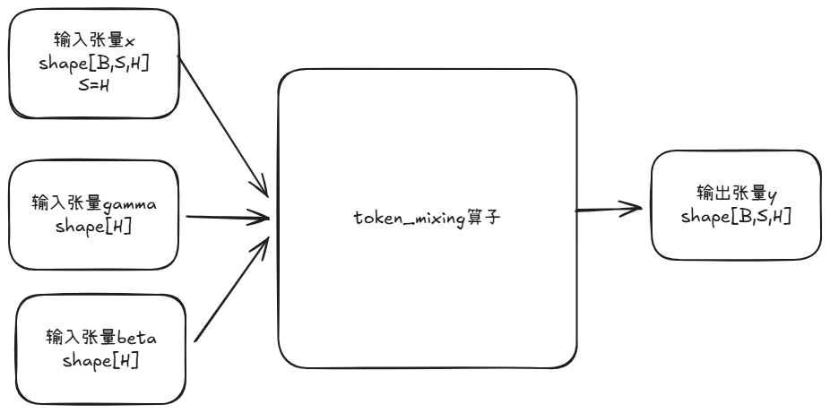

# token_mixing

## 产品支持情况

| 产品 | 是否支持 |
| :--- | :------: |
| Atlas A5 训练系列产品 | √ |
| Atlas A3 训练系列产品 | √ |
| Atlas A2 训练系列产品 | √ |

## 功能说明

实现x与其转置x_t相加后的归一化操作。
对输入 `x` 与其转置 `x_t` 求和后做 LayerNorm（带 `gamma` / `beta` / `epsilon`）。

计算公式：

```text
x_t = permute(x, [0, 2, 1])          # [B, S, H] -> [B, H, S]
y   = LayerNorm(x + x_t)             # 沿最后一维
LayerNorm(z) = rstd * (z - mean) * gamma + beta
```



对应接口：

- aclnn 接口：`aclnnTokenMixing`
- torch 接口：`ops_rec.ascendc.mixing.token_mixing`

## 算子实现原理

1. 输入张量x是一个三维张量(B,S,H)其中S与H相同
2. 输入张量x_t为x后两维转置后的矩阵
3. 算子将x与x_t相加得到tmp
4. 输出张量y为对tmp最后一维归一化的结果(layernorm)

## 参数说明

| 参数名 | 输入/输出 | 参数类型 | 数据类型 | 数据格式 | shape | 说明 |
|--------|---------|---------|---------|---------|-------|------|
| x | 输入 | Tensor | FLOAT32 | ND | [B, S, H] | 输入数据，仅支持三维张量S,H维度一致 |
| gamma | 输入 | Tensor | FLOAT32 | ND | [H] | LayerNorm 权重，仅支持一维张量 |
| beta | 输入 | Tensor | FLOAT32 | ND | [H] | LayerNorm 偏置，仅支持一维张量 |
| epsilon | 输入 (属性) | float | — | — | — |极小数，防除零，默认 `1e-7` |
| y | 输出 | Tensor | FLOAT32 | ND | [B, H, S] | 输出数据，融合算子归一化结果张量。与 `x_t` 同形；约束 `S == H`，故与 `x` 的 `[B, S, H]` 尺寸相同 |

## 约束说明

- 仅支持 FLOAT32 数据类型
- `x` 必须为 3D；`gamma` / `beta` 必须为 1D 且长度等于 `H`
- 转置混合在 `S == H` 时语义正确（kernel 按 `[B*S, H]` 行布局读写）
- 该算子需要在 NPU 设备上运行

> 通过 torch 接口调用时，扩展层还会额外校验：输入 tensor 必须已定义且非空、`x` 为 3 维、`gamma` / `beta` 为 1 维、所有输入 tensor 必须位于同一 NPU 设备。详见 [token_mixing 接口文档](./docs/torch_token_mixing.md)。

## 调用示例

- [aclnn 调用示例](./examples/aclnn/test_aclnn_token_mixing.cpp)
- [torch 调用示例](./examples/torch/test_torch_token_mixing.py)
- [aclnn 接口文档](./docs/aclnn_token_mixing.md)
- [torch 接口文档](./docs/torch_token_mixing.md)
